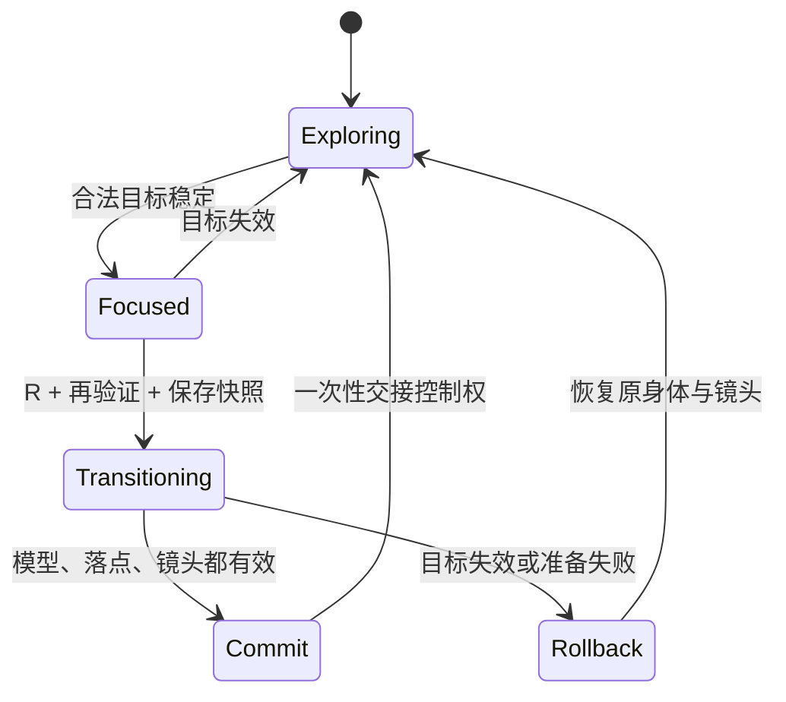

# 魂穿规格 · 核心玩法合同

版本：0.4-review · 2026-11-01（2026-11-03 按 D-021 更新尺度关系）。关联规则：P-01～P-16、W-02、W-05、W-06、L-03。**本文件描述目标实现；当前原型只有部分基础，差距见第 9 节。**

## 1. 参与对象与不变量

- 身体种类：`data/entities.json` 中声明的全部种类（当前 11 种）。`stage`（L0～L3）是渲染尺度层，决定镜头、雾与细节隐藏；`scaleTier`（S1～S5）是魂穿尺度档，决定能进入谁（D-021）。种类 ID 与实例 ID 不同，同一种类有多个实例。
- 当前主体：唯一接受玩家控制的实例；没有被控制的身体仍然存在于原处。
- 主目标：当前可以用 R 进入的一个实例；为空也是合法状态。
- 目标准备好：模型（或已验证的占位）、动作、碰撞、镜头配置、感知档案、落点与活动区限制全部可用。
- 任意时刻最多一个当前主体、一个过渡事务、一个显示涟漪的目标。失败恢复不得复制、丢失或重置无关实体。

## 2. 目标合法性

按顺序检查，任一项不成立就排除：

1. 实例存在、允许魂穿、不是当前主体，未被本次过渡锁定。
2. 目标的尺度档在当前身体的本档或相邻档内，或在视点抬升后可达的上一档内（P-12、P-15，见下文）。
3. 距离在当前身体的魂穿距离内。承载自己的整体（P-13）以表面距离计算，视为 0。
4. 目标至少有可辨认的一部分在相机视锥内；背后的目标不能选中。
5. 可辨认部分在屏幕上足够大。太小而无法辨认的目标（例如巨岩视角下的一株草）不能选中，即使关系允许。
6. 相机到可辨认部分的视线没有被地形、岩石、树或其他实心实体完全遮挡；不能只检查目标中心。
7. 水面以下的目标只在渲染上确实看得见时才合法；浑浊或反射完全挡住时不能盲选。
8. 目标已准备好，进入后的位置有效。资源尚未就绪的目标不显示涟漪。

每个种类可以配置若干可见性采样点，至少一个具有足够屏幕面积的部分通过即合法。屏幕面积阈值属于 P-11，可以按模型调整。

### 尺度档与视点抬升（P-12、P-15、P-16、D-021）

设计依据：魂穿要先看得见。成为草时连树冠都难看全，更看不见整座岛；视角一次只放大一档，尺度变化才可感知。

```text
可进入的档 = [体型档 − 1, 视界档 + 1]
视界档     = max(体型档, 视点抬升档)
```

| 档 | 名称 | 参考尺寸 | 当前成员 | 视点抬升阈值（初值） |
| --- | --- | --- | --- | --- |
| S1 | 近地 | 0.1–1 m | 草、狗、海鸥、银斧鱼、七彩神仙鱼 | — |
| S2 | 人身 | 1–5 m | 人、海岸岩石 | 视点离地 3 m |
| S3 | 林冠 | 5–30 m | 阔叶树、松树 | 视点离地 15 m |
| S4 | 地貌 | 30–300 m | 海岸巨岩 | 视点离地 60 m |
| S5 | 群岛 | 300 m 以上 | 岛屿 | — |

- **体型档**由种类在数据中显式声明（`scaleTier`），不按模型尺寸自动计算，替换资产不会改变玩法关系（L-04）。参考尺寸取身高与体长／翼展中较大者，只用于归档和校验；超出范围须写 `scaleTierReason`（例如海鸥翼展略超 1 m，仍归近地）。
- **相邻**只按有成员的档计算：预留或暂时清空的档不会把梯子断开。
- **视点抬升**：视点离正下方地面或水面的高度达到某档阈值时，视界抬到该档。它只扩展向上，不扩展向下：高飞的鸟能进入巨岩和岛，但不会因此获得岛的向下关系。已获得的抬升在视点低于“阈值 ×（1 − `viewLiftHysteresis`）”时才撤销，避免涟漪闪烁；按 R 时以当时的视点重新判断。地面身体的视点约等于身高，因此抬升实际上只作用于飞行身体。
- **例外**：极少数需要跨档或禁止的关系写在该种类的 `relationOverrides`（`allow`／`deny`／`decision`），必须对应 09 中的决定，由校验器列出。
- **梯子完整**（W-05）：每座岛从自身往下每一档都承载至少一个身体；其他承载体在所载最小身体与自身之间不断档。`validate_docs.py` 自动检查。

设计上有两条上岛路线：逐级长大（人 → 树 → 巨岩 → 岛），以及飞上去看（人 → 鸟 → 升到约 60 m 以上看向大地 → 岛）。

## 3. 承载整体：脚下的大地（P-13、D-021）

身体在岛上或岛附近时，岛不是“远处的一个物体”，而是脚下的大地。只有关系允许时（P-12、P-15），它才可能成为目标，例如岛上的巨岩、高飞到地貌视界的鸟、巨岩上的松树之于巨岩。规则：

- 承载整体的可辨认局部是：岸线与海的分界、开阔地表、山体轮廓。
- 只有当镜头看向这些局部、并且没有更对准或角度近似的合法子代目标时，承载整体才成为主目标。树与脚下岛的角度在容差内时选树；明显转向空地时选岛。
- 涟漪出现在玩家看向的那片大地上，而不是岛的几何中心。
- 设计意图（G-07）：干净开局是人；沿尺度档逐级长大到巨岩，或成为鸟飞到足够高处，看向大地并让岛成为涟漪主目标，就可以按 R 成为岛。草、人、树看不见整座岛，按规则也够不到；这不是解锁或任务锁，而是视野本身的尺度。

巨岩上的松树和草，承载整体是巨岩，同样适用。

## 4. 排序与稳定性

合法性过滤后依次缩小候选集合，而不是把各种因素加权相加：

```text
以最小夹角为基准保留角度容差内的候选
→ 剔除组内仍有合法子代候选的承载整体
→ 以最短距离为基准保留距离容差内的候选
→ 比较设计优先级，再用实例 ID 打破平局
```

初值：角度容差 1.5°、选中稳定 0.12 秒、距离容差 0.15 米，见 `data/tuning.json`。旧目标仍合法且与新目标近似时可以短暂保持，避免闪烁；旧目标一旦非法立即清空。按 R 的瞬间重新完整校验，不信任上一帧缓存。

判定示例：树和其承载的岛均合法且夹角在容差内时选树，即使岛的表面距离记为 0；树明显偏离观察方向、空地更对准时选岛；树被完全遮挡或关系不允许时，不得靠优先级选树。比较多个候选时，以最小夹角为基准形成角度容差组，避免随遍历顺序改变结果；在该组中剔除仍有合法子代候选的承载整体，再比较其余候选的距离和优先级（D-019）。

成为岛后，原先的身体仍在原位，但岛不能绕过 P-12 直接返回；须先选可见巨岩，再经松树、海岸岩石等逐级返回草。返回旧身体不是专用撤销操作。

## 5. 状态机与提交点



过渡快照保存原实例 ID、变换、速度、相机、感知档案、音景、目标 ID 和事务 ID。准备期间原身体仍是权威主体，提交时一次性交接；只在提交后保存，不把过渡中的状态写进存档。

## 6. 连续体验

默认总时长 2.4 秒（P-10，1.5–3 秒可调）：

1. 前段：镜头离开旧身体，向目标靠近。
2. 中段：利用目标的材质、光和雾完成尺度重建——雾距、观察距离、细节可见层级逐渐切到新尺度（C-06、W-06）；视觉与听觉感知档案同步淡化（P-14），例如进入狗时颜色逐渐褪成黑白。
3. 后段：镜头落到新身体的第三人称位置，完整主体入镜。

镜头路径按遮挡调整，不穿入任何模型（M-01）。过渡期间冻结移动、加速和重复 R；Esc 暂停过渡计时，恢复后继续；结束时清空过渡中积累的移动输入，避免一落位就冲出去。旧身体停在交接前的位置，不生成替身。

## 7. 尺度变化时的世界

- 进入更大尺度后，比当前层低一层以上的实体可以不渲染（`scaleHideBelowStageOffset`，W-07），但位置、朝向和状态全部保留。
- 成为岛并漂移时，岛上的一切随岛移动；回到人或草的尺度时，它们出现在随岛移动后的位置（W-06）。
- 成为巨岩并移动时，其上的松树与草一起移动；“其上”以 `carrier` 关系为准。当前主岛 `boulder-main` 有 4 棵松树与 4 株草；邻岛的植被承载在岛面，不随邻岛巨岩移动，见 [05](05-world-layout.md)。
- 同层大身体互不重叠（M-05）：岛漂向邻岛时会被挡住、沿边滑开。

## 8. 失败与回退

| 情形 | 预期行为 |
| --- | --- |
| 没有目标时按 R | 无状态变化、无提示 |
| 按 R 前目标刚被遮挡或移走 | 再验证失败，取消主目标，继续当前身体 |
| 过渡中目标失效或落点被占 | 在 1 秒内沿连续镜头回到原身体快照，解除输入锁 |
| 目标资产加载失败，占位可用 | 使用占位，经过同样的碰撞与镜头检查后进入；记录降级 |
| 资产和占位都失败 | 不进入该目标，保留原身体；不得卡在加载或镜头中 |
| 页面刷新时正处于过渡 | 从最近一次已提交的稳定状态恢复；没有则回到起点 |

加载超时 10 秒，回退镜头不超过 1 秒，均为可调初值。

## 9. 当前实现与验证

当前实现、自动覆盖和剩余缺口统一见 [11 原型审计](11-prototype-audit.md) 的“逐项对照”与“D-015 交叉审计”；变更与实际验证见 [CHANGELOG](../project/CHANGELOG.md)。本规格定义目标行为，不另维护会随代码变化的状态副本，自动回归不等于 QA-05～QA-16 的完整验收。
