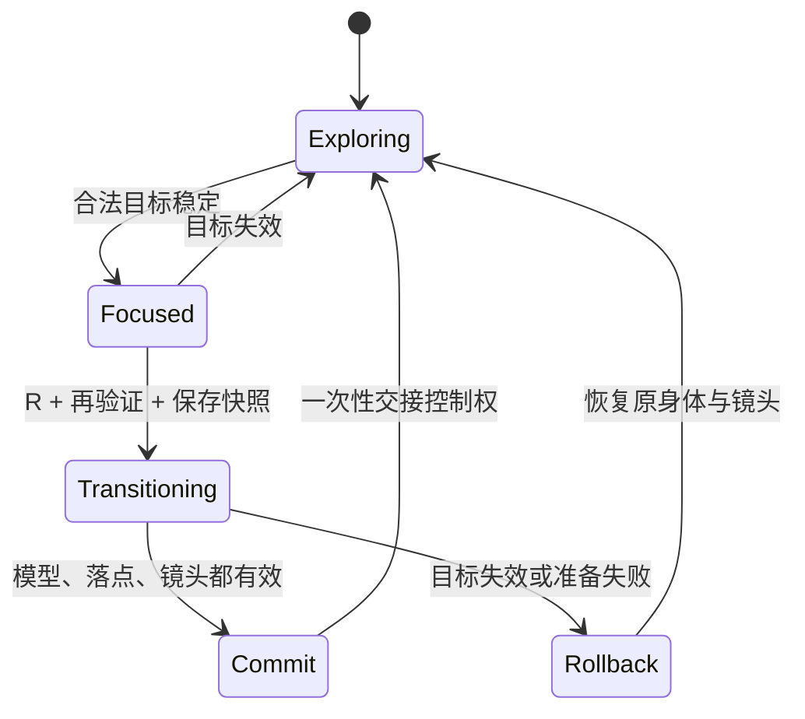

# 魂穿规格 · 核心玩法合同

版本：0.3-review · 2026-11-01。关联规则：P-01～P-14、W-02、W-05、W-06、L-03。**本文件描述目标实现；当前原型只有部分基础，差距见第 9 节。**

## 1. 参与对象与不变量

- 身体种类：`data/entities.json` 中的 13 种，分属 L0～L3 四个尺度层。种类 ID 与实例 ID 不同，同一种类有多个实例。
- 当前主体：唯一接受玩家控制的实例；没有被控制的身体仍然存在于原处。
- 主目标：当前可以用 R 进入的一个实例；为空也是合法状态。
- 目标准备好：模型（或已验证的占位）、动作、碰撞、镜头配置、感知档案、落点与活动区限制全部可用。
- 任意时刻最多一个当前主体、一个过渡事务、一个显示涟漪的目标。失败恢复不得复制、丢失或重置无关实体。

## 2. 目标合法性

按顺序检查，任一项不成立就排除：

1. 实例存在、允许魂穿、不是当前主体，未被本次过渡锁定。
2. 种类关系在当前种类的 `allowedTargets` 中（P-12）。
3. 距离在当前身体的魂穿距离内。承载自己的整体（P-13）以表面距离计算，视为 0。
4. 目标至少有可辨认的一部分在相机视锥内；背后的目标不能选中。
5. 可辨认部分在屏幕上足够大。太小而无法辨认的目标（例如巨岩视角下的一株草）不能选中，即使关系允许。
6. 相机到可辨认部分的视线没有被地形、岩石、树或其他实心实体完全遮挡；不能只检查目标中心。
7. 水面以下的目标只在渲染上确实看得见时才合法；浑浊或反射完全挡住时不能盲选。
8. 目标已准备好，进入后的位置有效。资源尚未就绪的目标不显示涟漪。

每个种类可以配置若干可见性采样点，至少一个具有足够屏幕面积的部分通过即合法。屏幕面积阈值属于 P-11，可以按模型调整。

## 3. 承载整体：人看见岛（P-13）

身体层的人、狗、鸟、树等站在或飞在岛上时，岛不是“远处的一个物体”，而是脚下的大地。规则：

- 承载整体的可辨认局部是：岸线与海的分界、开阔地表、山体轮廓。
- 只有当镜头看向这些局部、并且没有更对准的较小目标时，承载整体才成为主目标。看向一棵树，选中的应该是树而不是岛。
- 涟漪出现在玩家看向的那片大地上，而不是岛的几何中心。
- 设计意图（G-07）：玩家走到岸边、或作为鸟飞到高处，看到大地的边缘与海，意识到“脚下是一座岛”，按 R 成为岛。

巨岩上的松树和草，承载整体是巨岩，同样适用。

## 4. 排序与稳定性

合法性过滤后按词典序比较，而不是把各种因素加权相加：

```text
更接近镜头观察方向
→ 夹角在容差内才比较距离
→ 距离也近似相同时比较设计优先级（较小、较具体的目标优先于承载整体）
→ 最后用实例 ID 打破完全平局
```

初值：角度容差 1.5°、选中稳定 0.12 秒、距离容差 0.15 米，见 `data/tuning.json`。旧目标仍合法且与新目标近似时可以短暂保持，避免闪烁；旧目标一旦非法立即清空。按 R 的瞬间重新完整校验，不信任上一帧缓存。

## 5. 状态机与提交点



过渡快照保存原实例 ID、变换、速度、相机、感知档案、音景、目标 ID 和事务 ID。准备期间原身体仍是权威主体，提交时一次性交接；只在提交后保存，不把过渡中的状态写进存档。

## 6. 连续体验

默认总时长 2.4 秒（P-10，1.5–3 秒可调）：

1. 前段：镜头离开旧身体，向目标靠近。
2. 中段：利用目标的材质、光和雾完成尺度重建——雾距、观察距离、细节可见层级逐渐切到新尺度（C-06、W-06）；视觉与听觉感知档案同步淡化（P-14），例如进入狗时颜色逐渐褪成黑白。
3. 后段：镜头落到新身体的第三人称位置，完整主体入镜。

镜头路径按遮挡调整，不穿入任何模型（M-01）。过渡期间冻结移动、加速和重复 R；Esc 暂停过渡计时，恢复后继续；结束时清空过渡中积累的移动输入，避免一落位就冲出去。旧身体停在交接前的位置，不生成替身。

## 7. 尺度变化时的世界

- 进入更大尺度后，比当前层低一层以上的实体可以不渲染（`scaleHideBelowStageOffset`，W-07），但位置、朝向和状态全部保留。
- 成为岛并漂移时，岛上的一切随岛移动；回到人或草的尺度时，它们出现在随岛移动后的位置（W-06）。
- 成为巨岩并移动时，其上的松树与草一起移动。
- 同层大身体互不重叠（M-05）：岛漂向邻岛时会被挡住、沿边滑开。

## 8. 失败与回退

| 情形 | 预期行为 |
| --- | --- |
| 没有目标时按 R | 无状态变化、无提示 |
| 按 R 前目标刚被遮挡或移走 | 再验证失败，取消主目标，继续当前身体 |
| 过渡中目标失效或落点被占 | 在 1 秒内沿连续镜头回到原身体快照，解除输入锁 |
| 目标资产加载失败，占位可用 | 使用占位，经过同样的碰撞与镜头检查后进入；记录降级 |
| 资产和占位都失败 | 不进入该目标，保留原身体；不得卡在加载或镜头中 |
| 页面刷新时正处于过渡 | 从最近一次已提交的稳定状态恢复；没有则回到起点 |

加载超时 10 秒，回退镜头不超过 1 秒，均为可调初值。

## 9. 当前代码差距

2026-11-01 TASK-RUNTIME 后已实现：R 再验证、过渡结束才交接控制权、目标消失时回滚、词典序选择、屏幕角尺寸阈值、实心实体遮挡（包围盒近似）、承载整体（P-13）、感知在过渡中连续混合。

仍缺：目标资产的“准备好”状态与加载超时纳入事务（目前资产在启动时统一加载，失败即用占位）；可见性多采样点；故障注入测试（QA-11）。

这些是迁移任务，详见 [11 原型审计](11-prototype-audit.md) 与 [TASKS](../project/TASKS.md)；验收用 QA-05～QA-16。
