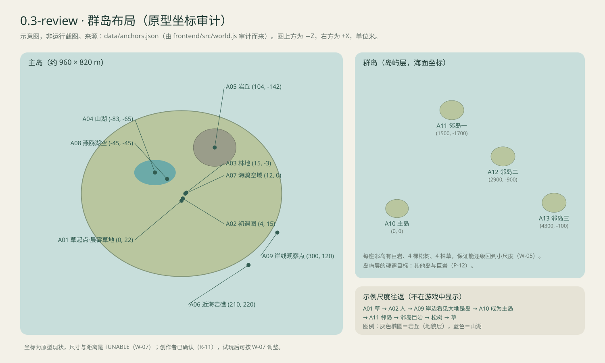

# 世界布局

版本：0.4-review · 2026-11-01。数据：[anchors.json](../data/anchors.json)。**世界布局的唯一来源（W-08）：游戏启动时从这里读取个体与成片布景，加个体、加一片树林只改这个文件，方法见 [数据与扩展指南](../data/README.md)。**

## 结构

首版世界是一座可以细致探索的主岛，加上周边三座邻岛与海（G-04、W-01）。不再是“只有一块小岛”：岛本身是可以成为的存在，所以岛的外面必须有海、有其他岛，岛屿视角才有可以探索和进入的东西（W-05）。

| 区域 | 位置（X, Z） | 主要存在 | 作用 |
| --- | --- | --- | --- |
| A01 晨雾草地 | (0, 22) | 草、5 株同伴草 | 近地观察点；草仍可作为早期魂穿目标 |
| A02 初遇圈 | (4, 15) | 人、狗、海岸岩石、第一棵阔叶树 | 人类出生点（`human-first`）；附近目标在人的魂穿距离内（G-06） |
| A03 林地 | (15, -3) 及周边 | 阔叶树、松树 | 树冠视角 |
| A04 山湖 | (-83, -65)，湖面 y=5.8 | 银斧鱼群（12 条）、七彩神仙鱼（6 条） | 鱼的淡水世界；银斧鱼贴近水面成群来回游，七彩神仙鱼单只在较深处巡游（D-027） |
| A05 岩丘 | (104, -142) | 海岸巨岩，上有 4 棵松树、1 块海岸岩石、4 株草 | 地貌档；逐级上岛的最后一级（巨岩 → 岛）；移动时携带其上的存在 |
| A06 近海岩礁 | (210, 220)，水下 | （D-027 后无鱼） | 原蝴蝶鱼位置；鱼类现都在山湖 |
| A07／A08 空域 | 林地、草地、湖面与海岸上空 | 海鸥 4 只，各沿 `ambient` 环线单飞 | 飞到高处看见岛的轮廓；约 60 m 以上看向大地可成为岛（P-15）；每条航线都有一段低飞，供地面身体选中（D-027） |
| A14 草地低飞海鸥 | (-1.5, 2)，离地 2.5 m | 海鸥 `gull-0` 的低飞点 | `gull-0` 约每 32 秒从人出生点前方约 12 米处减速低飞经过，人平视即可选中，是“人 → 鸟”路线的起点（G-07）；人与狗视线不能上仰，高飞时无法从地面选中 |
| A09 岸线观察点 | (300, 120) | 岸、海 | 人或狗走到这里，看见大地的边缘与海；这里只预示“脚下是岛”，人仍要借鸟飞高或逐级长大才能成为岛（D-021） |
| A10 主岛 | 海面原点 | 岛屿 | 岛屿层 |
| A11～A13 邻岛 | (1500, -1700)、(2900, -900)、(4300, -100) | 岛屿；各有巨岩、4 棵松树、4 块海岸岩石、4 株草 | 岛屿层的目标与返回小尺度的入口 |

主岛坐标是岛的局部坐标（原点在岛中心）；邻岛坐标是海面坐标。成为主岛并漂移后，主岛局部坐标整体随岛移动。

承载关系不要与邻近关系混用：主岛岩丘的 4 棵松树、1 块海岸岩石（`rock-boulder-0`）和 4 株草以 `boulder-main` 为 `carrier`，随巨岩移动；三座邻岛各有 4 棵松树、4 块海岸岩石（`rocks-island-N`）和 4 株草，位于巨岩周围，`carrier` 是对应岛，随岛移动但不随巨岩移动。返回路径指魂穿可达，不意味着所有返回目标都放在巨岩上。QA-16 的巨岩携带先用主岛岩丘验证。

## 核心时刻怎样发生（G-07）

不是任务，也不显示路线。布局要让它自然发生：

1. 干净开局直接控制初遇圈的人，近处草、狗、岩石和树可供首次魂穿。
2. 草地另一边的海光与浪声吸引探索；玩家可以继续用人，也可自由切换其他身体。
3. 在 A09 一带，人看见大地在脚下终止、海在外面展开，但人的视界还够不到整座岛。要成为岛，可以逐级长大（人 → 林地的树 → A05 岩丘 → 看向开阔地面），或成为鸟飞到约 60 m 以上再看向大地；此时脚下的地面出现涟漪（P-13、P-15）。
4. 按 R，镜头退远：草、人、树渐渐隐去，整座岛的轮廓、海面和邻岛出现（C-06、W-06）。
5. 作为岛可以漂向邻岛；看向邻岛或其巨岩再按 R，经松树、海岸岩石逐级回到草。
6. 回到主岛的小尺度时，世界随岛一起移动过，状态连续。

这只是演示路径，不是任务锁：规则只有尺度档相邻与视点抬升（D-021）。草、人、树看不见整座岛，所以不会出现岛的涟漪；巨岩和高飞的鸟能。

## 推荐演示节奏（不是任务链）

| 时间 | 观察与行动 | 验证点 |
| --- | --- | --- |
| 0–30 秒 | 人看见近处的草、狗或树，出现涟漪与一次短暂的 R 提示，第一次魂穿 | 新玩家理解 R |
| 30–90 秒 | 成为狗，世界变成黑白，远处的声音变得清楚；或成为鸟飞起 | 感知差异 |
| 90–180 秒 | 逐级长大到巨岩，或成为鸟飞高，看见岛的可辨认局部，选中涟漪并成为岛 | 核心时刻；记录玩家是否自然找到两条路线之一 |
| 180–300 秒 | 作为岛漂移、看见邻岛；经巨岩、松树、海岸岩石回到草 | 尺度往返与状态连续 |

顺序完全自由，玩家也可以只在湖里当鱼。

## 玩家体验参照（不规定路线）

| 阶段 | 希望玩家注意到什么 | 设计与试玩观察 |
| --- | --- | --- |
| 人开场 | 身边的存在可以成为另一个观察点 | 草、狗或树的涟漪与 R 提示易于看见；记录是否理解目标与按键的关系 |
| 换成草、狗或其他身体 | 熟悉地点因身体而不同 | 草的近地尺度、狗的黑白与定向鸟叫分别有可比较的参照；没选择某身体也不妨碍继续探索 |
| 成为岛 | 之前行走的大地原来也是一个存在 | 过渡保留地标方向和空间联系，岛与群岛轮廓可辨；不依赖必须阅读引文才能理解 |
| 返回小尺度 | 熟悉的地方仍在，并随承载体移动 | 用可辨认地标和返回路径观察变化；不要求玩家记住精确坐标 |

草可穿过窄处、狗辨认远处声音、树冠远眺、鸟飞行和鱼水下探索等体验，应结合 [04](04-entity-catalog.md) 的能力状态选取适合地点试玩；窄处、部分音景及正式构图仍待制作，表中意图不代表现已实现。若新玩家错过首次 R 提示，记录错过的条件与再次帮助的需要；渐进重复提示是待评审方案，触发时机和形式待试玩，不作为现有功能或强制新增范围。

## 返回路径核查（待实际验证）

下表是测试起点与预期候选，不是已通过证明；每项需记录位置、镜头、遮挡、实际涟漪及之后能否继续返回草。先寻找合法目标，不要求每个视角都立刻有涟漪；典型位置的合法目标要求仍按 W-05。

| 起点 | 预期下一步与检查重点 |
| --- | --- |
| 主岛草地的人或草 | 周边合法身体（草→人／狗／鸟／岩石，人→树）；确认岛面不出现涟漪 |
| 山湖的银斧鱼与七彩神仙鱼 | 同水体内可见目标或透过水面可辨认的近地／人身档目标；检查水面遮挡与距离 |
| 主岛巨岩及其上的草 | 巨岩：可辨认的树、岛面；巨岩上的草：海岸岩石 `rock-boulder-0`；检查承载关系和巨岩移动后位置 |
| 邻岛、邻岛巨岩 | 岛先到可见巨岩，再到松树、海岸岩石、草；分别检查岛漂移及巨岩移动后遮挡与距离 |

若某起点找不到路线，记录复现并调整合法的布局、构图或目标可见性；不要用传送或绕过尺度关系冒充已验证的自然返回。边界处是否需要额外帮助待试玩评审。

## 活动区

- 地面身体：陆地与浅岸；接近深水时减速、沿岸滑行。
- 鱼：所在水体内，当前两种鱼都在山湖。水体是 `anchors.json` 中带 `water` 字段的区域：山湖 `lake`（封闭水体，水面 5.8 米，带程序地形湖盆）与海 `ocean`（海平面 -0.1 米）；新增湖或池塘只加数据，见 [数据与扩展指南](../data/README.md)。
- 飞行身体（当前是海鸥）：在其 `activityRegion` 指定的空域内——主岛空域 `island_airspace`，水平半径 760 米、离地至少 0.3 米（`anchors.json`），高度上限初值 180 米（`tuning.json` 的 `flightCeilingM`）。新增会飞的种类只需指向一个空域。
- 岛：群岛之间的海面，不与邻岛重叠。
- 世界外缘以雾、海与软边界组织，不用死亡区。

## 布局评审要点

- **尺寸与效率**：主岛约 960 × 820 米、邻岛相距一两千米，是原型现状。以人 6 米／秒、加速 2.7 倍计算，从起点走到 A09 岸边约需 20–50 秒。创作者已确认这一尺寸（R-11）；试玩后如果仍觉得太远，按 W-07 调整并记录。
- **首个视野**：人类出生点周围有草、狗、岩石和树，至少一个合法目标在人的魂穿距离内；首次 R 不要求先成为草。
- **返回保证**：每座岛从自身往下每个尺度档都有落脚点——邻岛有巨岩、松树、海岸岩石和草；主岛岩丘上有松树、海岸岩石和草（W-05，`validate_docs.py` 检查梯子完整）。
- **数据结构**：`instances` 是具名个体（草地中的草、开场的人、第一只狗、邻岛与其上的巨岩等，共 74 个）；`scatter` 是成片布景（草地上的散草、林地、岩石，以及三座邻岛的海岸岩石，共 10 组）；`regions` 是湖、湖岸、海与空域等区域，其中带 `water` 的是水体。随机布景与实心物体重叠时在出生时移除。`ambient` 是海鸥与鱼的环境航线（D-027）：每组列出成员、形状（`ellipse`／`figure8`）、中心、半径、周期、高度方式（`aboveGround` 的高低与低飞点，或 `belowSurface` 的水下深度）、队形与离开后的恢复时间；个体在 `instances` 中的位置只是出生点。
